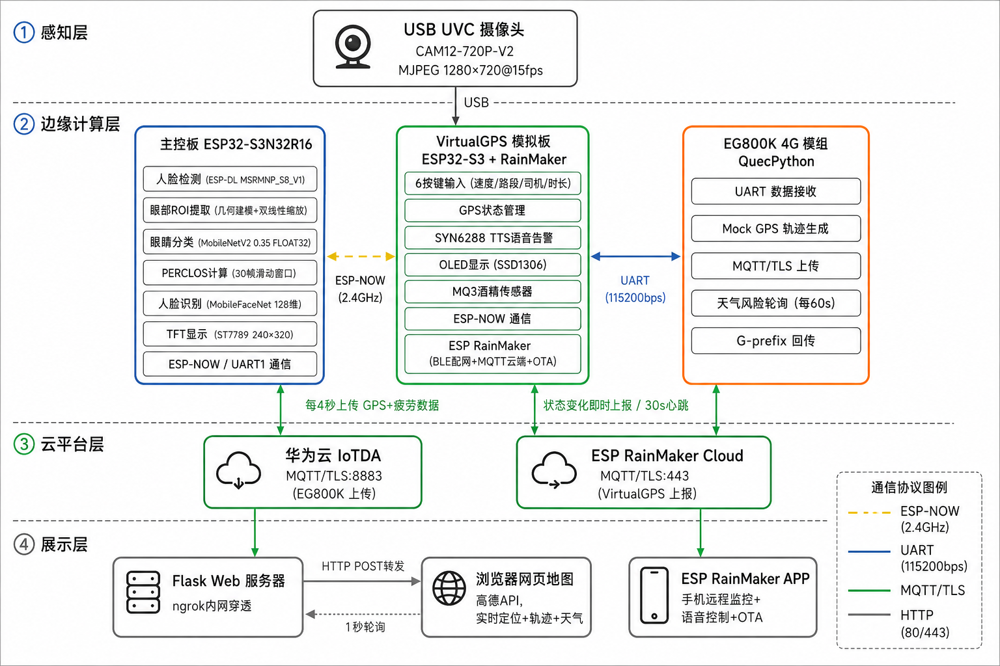
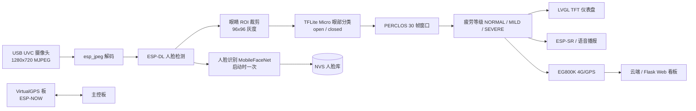
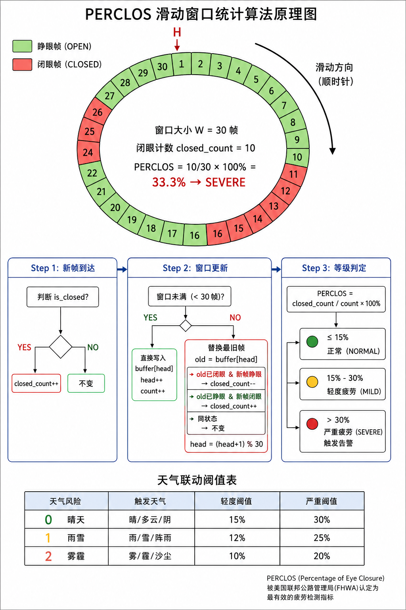

# 驾盾 FatigueGuard

> 基于 ESP32-S3 + USB UVC 的边缘 AI 驾驶员疲劳监测与安全预警系统

[](https://github.com/wwwwyyykkk/-Fatigue-Detection/actions/workflows/ci.yml)

> **版本说明**：当前 `main` 是完整的 **ESP-IDF + USB UVC** 版本。  
> 早期 Arduino + OV5640 原型保留在 `legacy/arduino-ov5640` 分支，不在当前主线中。

## 项目简介

驾盾面向车载安全场景，在 ESP32-S3 上运行完整的边缘 AI 推理链路：

```text
USB UVC 摄像头 → MJPEG 解码 → 人脸检测 → 眼睛 ROI → 眼部分类 → PERCLOS
              → 疲劳等级 → TFT 显示 / 语音提醒 / 4G 上报 / Web 看板
```

系统不依赖云端推理，人脸检测、眼睛状态分类、PERCLOS 计算都在设备本地完成，降低延迟与隐私风险。项目获 **2026 年全国大学生嵌入式芯片与系统设计竞赛（应用赛道）全国三等奖**。

## 功能特性

- **USB UVC 摄像头**：CAM12-720P-V2，MJPEG 1280×720，每 10 帧处理 1 帧
- **人脸检测**：ESP-DL `HumanFaceDetect`（MSRMNP_S8_V1）
- **眼睛状态分类**：MobileNetV2 0.35，96×96，FLOAT32，验证集准确率 84.6%
- **PERCLOS 疲劳判定**：30 帧滑动窗口，三级疲劳状态
- **人脸身份确认**：MobileFaceNet 112×112，128 维特征，NVS 注册/识别
- **TFT 仪表盘**：LVGL 9 + ST7789 240×320，显示 PERCLOS 仪表、趋势曲线、驾驶信息
- **语音交互**：ESP-SR 离线语音识别 + MAX98357 I2S 语音播报
- **4G/GPS 与云端**：EG800K 模组，MQTT 上报，Flask + 高德地图 Web 看板
- **多板协同**：主控板 ↔ ESP-NOW ↔ VirtualGPS 板
- **酒精检测**：MQ-3 传感器（VirtualGPS 板）
- **工程质量**：主机端 C++ 单元测试 + GitHub Actions CI

## 系统架构





全链路数据流见 [`docs/images/全链路数据流图.png`](docs/images/全链路数据流图.png)，详细流程见 [`docs/system_workflow.md`](docs/system_workflow.md)。

## 硬件清单

| 模块 | 型号 / 说明 |
|---|---|
| 主控 | ESP32-S3N32R16（32MB Flash，16MB PSRAM） |
| 摄像头 | CAM12-720P-V2，USB UVC，MJPEG 720p |
| 显示 | ST7789 240×320，SPI |
| 语音识别 | USB UAC 麦克风 + ESP-SR |
| 语音播报 | MAX98357 I2S 功放 + 喇叭 |
| 4G/GPS | EG800K 模组，UART |
| 酒精检测 | MQ-3 模拟传感器（VirtualGPS 板） |
| 副板 | VirtualGPS：ESP32-S3 + SYN6288 TTS + ESP-SR + OLED |

USB 摄像头接线、USB PHY 冲突与外部 UART 调试说明见 [`docs/USB_CAMERA_WIRING.md`](docs/USB_CAMERA_WIRING.md)。

> **注意**：USB UVC 使用 USB-OTG（GPIO19/20），运行时板载 USB-Serial-JTAG 会失效，需要通过 GPIO43/44 外接 USB 转 UART 查看日志。

## 软件结构

```text
Fatigue-Detection/
├── main/                       # ESP-IDF 主组件
│   ├── main.cpp                # UVC、人脸检测、眼部分类、PERCLOS、任务调度
│   ├── perclos.hpp             # PERCLOS 计算器 + 疲劳等级 + 天气联动阈值
│   ├── eye_roi.hpp             # 人脸框 → 眼睛 ROI 裁剪
│   ├── mouth_roi.hpp           # 嘴部 ROI（扩展用）
│   ├── lvgl_ui.cpp             # LVGL 界面
│   ├── ScreenDriver.cpp        # ST7789 驱动
│   ├── gps_uart.cpp            # EG800K GPS/4G 串口
│   ├── esp_sr_task.cpp         # ESP-SR 语音识别
│   ├── mic_test.cpp            # UAC 麦克风测试
│   └── voice/                  # 提示音 WAV
├── components/
│   ├── eye_classifier/         # 眼部分类（TFLite Micro + MobileNetV2）
│   ├── face_recognizer/        # 人脸识别（MobileFaceNet + NVS）
│   ├── cloud_face/             # 云端人脸相关
│   ├── esp_now_link/           # 双板 ESP-NOW 通信
│   └── voice_prompter/         # I2S 语音播报
├── virtualgps/                 # VirtualGPS 副板固件
├── tools/                      # 数据准备、训练、TFLite 转换、分析脚本
├── docs/                       # 系统流程、接线、PERCLOS、显示文档
├── host_test/                  # PC 端 C++ 单元测试
├── CMakeLists.txt
├── partitions.csv
├── sdkconfig.defaults
└── .github/workflows/ci.yml
```

## AI 模型与部署

### 眼部分类模型

- **训练**：Edge Impulse 自定义训练脚本
- **数据**：530 张眼部灰度图（248 open + 282 closed）+ 强数据增强
- **模型**：MobileNetV2 0.35，96×96 单通道
- **导出**：FLOAT32 TFLite → C 字节数组嵌入固件
- **验证集准确率**：84.6%
- **Tensor Arena**：685 KB，放在 PSRAM
- **推理速度**：约 1.9 s/帧（FLOAT32 reference ops）

### 踩过的坑

| 问题 | 原因 | 解决 |
|---|---|---|
| INT8 输出恒为 `[127, -128]` | ESP-NN 在 ESP32-S3 上的量化内核饱和（汇编与 ANSI C 路径均存在） | 改用 FLOAT32，禁用 ESP-NN |
| 训练准确率只有 57% | Edge Impulse 输入为 `[0,1]`，MobileNetV2 预训练权重期望 `[-1,1]` | 训练脚本加 `Rescaling(2.0, -1)` |
| 输出标签对调 | 模型索引 `0=closed, 1=open` 与代码映射相反 | 修正 `eye_classifier_infer.cpp` 映射 |
| Tensor Arena 被 USB DMA 破坏 | 推理期间 USB DMA 写内部 SRAM | Arena 迁移到 PSRAM |
| ROI 切到鼻子 | 眼睛 ROI 参数偏大 | 调整到 `top=0.22, bottom=0.48, left=0.05, right=0.60` |

### 人脸识别

- **模型**：MobileFaceNet，112×112 RGB，128 维特征
- **注册**：特征向量存入 NVS `face_db`
- **识别**：余弦相似度，阈值 0.30
- **时机**：启动后首次检测到人脸时运行一次，避免影响后续 PERCLOS 流水线
- **开销**：Tensor Arena 约 3 MB（PSRAM），推理约 12.6 s（reference ops）

### 人脸检测

- ESP-DL `HumanFaceDetect`，模型 `MSRMNP_S8_V1`
- 模型放在 Flash RODATA，避免 USB DMA 与 PSRAM 冲突

## PERCLOS 与疲劳判定



- 滑动窗口：**30 帧**（约 6 s @ 5 fps 处理速率）
- 计算：`PERCLOS = 闭眼帧数 / 有效帧数 × 100%`
- 疲劳等级：
  - `PERCLOS ≤ 15%`：NORMAL
  - `15% < PERCLOS ≤ 30%`：MILD
  - `PERCLOS > 30%`：SEVERE
- 天气联动阈值：
  - 晴/多云：15% / 30%
  - 雨/雪：12% / 25%
  - 雾/霾：10% / 20%
- 驾驶时长提醒阈值也会随天气风险收紧（210 / 180 / 150 分钟）

实现见 [`main/perclos.hpp`](main/perclos.hpp)，设计说明见 [`docs/PERCLOS_implementation_notes.md`](docs/PERCLOS_implementation_notes.md)。

## 显示、语音与多板协同

- **TFT 显示**：Idle / Identifying / Monitoring / Rest 四页；Monitoring 页包含 PERCLOS 弧形仪表、120 点趋势曲线、GPS/速度/驾驶时长
- **语音识别**：ESP-SR 离线命令词，UAC 麦克风采集
- **语音播报**：MAX98357 I2S 功放，提示音由 WAV 转 C 数组
- **ESP-NOW**：主控板与 VirtualGPS 板通信
- **4G/GPS**：EG800K 串口上报，云端 Flask 页面展示轨迹/状态/天气
- **天气联动**：Web 端获取天气风险，回传后自动调整疲劳阈值

## 构建与运行

### 环境

- ESP-IDF **v5.5.x**
- 目标芯片：`esp32s3`
- Python 3.11（ESP-IDF 自带环境即可）
- 依赖组件由 `idf_component.yml` 管理，首次构建会自动下载到 `managed_components/`（不提交到仓库）

### 本地配置（不要提交真实密钥）

首次构建前，请把仓库中的占位符替换成本机配置：

- `main/main.cpp`：`BAIDU_API_KEY`、`BAIDU_SECRET_KEY`
- `main/main.cpp`：`WIFI_SSID`、`WIFI_PASSWORD`
- `virtualgps/main/config.h`：`WIFI_SSID`、`WIFI_PASSWORD`

> 这些值不要提交到 Git。建议在本地修改后使用 `git update-index --skip-worktree`，或者改造成 Kconfig/本地 `secrets.h` 方案。

### 编译

```powershell
cd Fatigue-Detection
idf.py set-target esp32s3
idf.py build
```

### 烧录与监视

```powershell
idf.py -p COMx flash monitor
```

> 由于 USB-OTG 会接管内部 PHY，运行时板载 USB 串口可能失效。建议按 [`docs/USB_CAMERA_WIRING.md`](docs/USB_CAMERA_WIRING.md) 使用 GPIO43/44 外接 USB 转 UART 查看日志。

### 关键配置

- `sdkconfig.defaults`：32MB Flash、OPI PSRAM、USB Host、ESP-DL、LVGL、ESP-SR、WiFi 内存裁剪
- `partitions.csv`：自定义分区表
- `idf_component.yml`：`usb_host_uvc`、`usb_host_uac`、`esp-dl`、`human_face_detect`、`esp-sr`、LVGL 等

## 主机端单元测试

`host_test/` 在 PC 上测试 `perclos.hpp` 的纯逻辑，不依赖 ESP-IDF 或硬件：

```powershell
cmake -S host_test -B build
cmake --build build
ctest --test-dir build --output-on-failure
```

覆盖内容：

- 空窗口 / 未填满窗口
- 15% 与 30% 边界
- 滑动窗口替换旧帧
- 天气联动阈值（晴 / 雨 / 雾）
- reset 行为

GitHub Actions 在每次 push / PR 时自动运行这些测试。

## 项目结果

- 眼部分类模型验证集准确率约 **84.6%**
- 端到端链路（USB 采集 → 人脸检测 → 眼部分类 → PERCLOS → 显示/上报）完成 **48 小时连续运行测试**
- 获 **全国大学生嵌入式芯片与系统设计竞赛（应用赛道）全国三等奖**
- 完成主控板 + VirtualGPS 副板 + EG800K 4G + Flask Web 看板的联调

## 设计文档

- [系统完整工作流程](docs/system_workflow.md)
- [USB 摄像头接线与调试](docs/USB_CAMERA_WIRING.md)
- [PERCLOS 实现说明](docs/PERCLOS_implementation_notes.md)
- [TFT 显示说明](docs/README-DISPLAY.md)
- [VirtualGPS Mock 方案](docs/mock-gps-plan.md)
- [答辩流程与讲稿](docs/答辩流程与讲稿.md)

## 已知限制 / Roadmap

- [ ] FLOAT32 推理约 1.9 s/帧；后续可评估 INT8 修复或更轻量模型
- [ ] 人脸识别启动时约 12.6 s，可改为后台任务/更轻量模型
- [ ] USB-OTG 与板载 USB-Serial-JTAG 共用 PHY，调试需外接 UART
- [ ] WiFi + USB UVC + TFLite 内存紧张，后续继续优化 buffer/任务栈
- [ ] 增加固件编译 CI（ESP-IDF Docker）
- [ ] 增加硬件在环测试与更多主机端测试
- [ ] 补充设备实物图与演示视频

## 旧版说明

早期 Arduino + OV5640 DVP 原型（`drivesafe/`、`ov5640_test/` 等）保留在：

```text
legacy/arduino-ov5640
```

当前 `main` 以 ESP-IDF + USB UVC 完整版为准。
