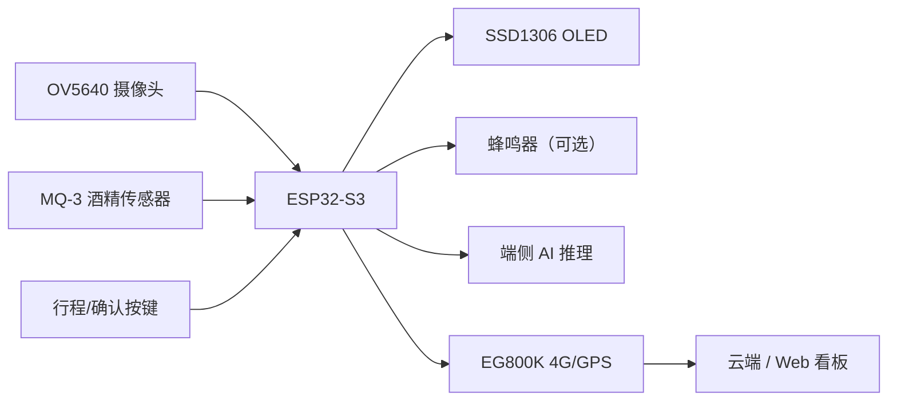

# 驾盾 DriveSafe Guardian

> 基于 ESP32-S3 的边缘 AI 驾驶员疲劳监测与安全预警系统

[](https://github.com/wwwwyyykkk/-Fatigue-Detection/actions/workflows/ci.yml)

## 项目简介

驾盾面向车载安全场景，在 ESP32-S3 上完成摄像头采集、端侧 AI 推理、疲劳判定、酒精检测、GPS/4G 上报与本地报警的完整闭环。系统不依赖云端推理，在设备本地完成人脸验证与疲劳检测，降低延迟与隐私风险。

项目获 **2026 年全国大学生嵌入式芯片与系统设计竞赛（应用赛道）全国三等奖**。

## 功能特性

- **端侧 AI**：人脸验证 + 疲劳检测模型在 ESP32-S3 本地推理
- **疲劳判定**：PERCLOS 滑动窗口 + 打哈欠统计 + 三级疲劳状态
- **酒精检测**：MQ-3 传感器预热、阈值判断与报警
- **五状态机**：`INIT / DRIVING / RESTING / UNKNOWN / FATIGUE`
- **安全评分**：行程结束按疲劳、酒精、离岗、驾驶时长扣分
- **本地交互**：SSD1306 OLED、行程/确认按键（蜂鸣器驱动可选，当前演示未接入）
- **远程上报**：EG800K 4G/GPS，JSON 定时上报；3.5h 休息点提醒、4h 强制报警
- **云端看板**：Web 页面展示状态、轨迹与行程报告
- **工程化**：主机端单元测试 + GitHub Actions CI

## 系统架构



数据流：

```text
图像采集 → 灰度/归一化 → 端侧推理 → EAR / MAR / 人脸置信度
        → PERCLOS + 打哈欠 + 五状态机 → OLED / 蜂鸣器
        → 4G JSON 上报 → Web 看板
```

## 硬件清单

| 模块 | 型号 / 说明 |
|---|---|
| 主控 | ESP32-S3-DevKitC-1，16MB Flash，OPI PSRAM |
| 摄像头 | OV5640（DVP） |
| 显示 | SSD1306 OLED（I2C） |
| 酒精 | MQ-3 模拟传感器（ADC） |
| 通信 | EG800K 4G/GPS 模组（UART） |
| 交互 | 行程按键、确认按键；蜂鸣器（可选，代码已支持，当前演示未接入） |

> 当前演示未接入蜂鸣器。如需声音报警，可接 GPIO38 并保留现有的 `buzzer.h` 驱动。

详细引脚接线见 [`drivesafe/README.md`](drivesafe/README.md)。

## 软件结构

```text
Fatigue-Detection/
├── drivesafe/                 # 主固件
│   ├── drivesafe.ino          # 主入口、摄像头、推理与任务
│   ├── config.h               # 引脚、阈值、参数
│   ├── state_machine.h/.cpp   # 五状态机、PERCLOS、打哈欠、评分
│   ├── oled_display.h         # OLED 界面
│   ├── buzzer.h               # 蜂鸣器 PWM
│   ├── mq3_alcohol.h          # 酒精检测
│   ├── eg800k_gps.h           # 4G/GPS 驱动
│   ├── net_report.h           # 网络上报任务
│   ├── web_dashboard.html     # 云端 Web 看板
│   └── README.md              # 部署、接线、模型导入说明
├── fatigue_test_1/            # 疲劳检测验证 sketch
├── locate_face/               # 人脸定位验证 sketch
├── ov5640_test/               # 摄像头 bring-up sketch
├── host_test/                 # PC 端单元测试
│   ├── src/perclos.c/.h
│   ├── test/test_perclos.c
│   └── CMakeLists.txt
├── .github/workflows/ci.yml   # GitHub Actions CI
└── README.md
```

## AI 模型

- **训练平台**：Edge Impulse
- **模型一**：人脸识别（`authorized` / `unknown`）
- **模型二**：疲劳检测（`face_conf` / `EAR` / `MAR`）
- **部署方式**：导出 Arduino 库，在 ESP32-S3 上本地推理
- **内存策略**：帧缓冲使用 PSRAM；模型内存由 Edge Impulse 推理库管理。两个模型串行加载，避免内部 RAM 不足

> 由于模型体积与授权原因，仓库不包含 Edge Impulse 导出的模型库。请按 [`drivesafe/README.md`](drivesafe/README.md) 自行训练/导出并导入。

## 疲劳判定

| 指标 | 规则 |
|---|---|
| PERCLOS | 60s 滑动窗口（300 帧 @5fps） |
| 正常 | PERCLOS ≤ 15% |
| 轻度 | 15% < PERCLOS ≤ 30% |
| 严重 | PERCLOS > 30% |
| 打哈欠 | MAR 超阈值并持续 1.5s，计入 10 分钟窗口 |

系统状态：

```text
INIT → DRIVING ⇄ RESTING
         ↓
      UNKNOWN / FATIGUE
```

- **FATIGUE**：疲劳或酒精报警，需睁眼恢复 + 按键确认
- **UNKNOWN**：车辆移动但未检测到人脸
- **RESTING**：停车休息
- 行程结束输出 0~100 安全评分

## 构建与运行

### 固件

Arduino IDE 配置：

| 选项 | 值 |
|---|---|
| Board | ESP32S3 Dev Module |
| PSRAM | OPI PSRAM |
| Flash Size | 16MB |
| Partition Scheme | Huge APP (3MB No OTA) |
| CPU Frequency | 240MHz |

依赖库：

- Adafruit SSD1306
- Adafruit GFX Library
- esp32-camera
- Edge Impulse 导出的 `face_recognition_inferencing` / `fatigue_detection_inferencing`

配置 `drivesafe/config.h`：

```cpp
#define AMAP_KEY    "你的高德 API Key"
#define SERVER_URL  "http://你的服务器地址/api/report"
```

然后打开 `drivesafe/drivesafe.ino` 编译上传。

### 主机端单元测试

```powershell
cmake -S host_test -B host_test/build
cmake --build host_test/build
ctest --test-dir host_test/build --output-on-failure
```

当前覆盖 `perclos_level()` 的边界与非法输入；后续计划扩展到状态机、协议解析、CRC 校验。

### CI

GitHub Actions 在每次 push / PR 时自动编译并运行主机端测试：

```yaml
cmake -S host_test -B build
cmake --build build
ctest --test-dir build --output-on-failure
```

## 演示流程

1. 上电，等待 MQ-3 预热（30 秒）和酒驾预检
2. 面向摄像头完成人脸验证
3. 按行程键开始行程
4. 持续闭眼/打哈欠触发 MILD / SEVERE 疲劳报警
5. 睁眼恢复 30 秒并按确认键解除报警
6. 车辆移动但检测不到人脸触发 UNKNOWN 离岗报警
7. 结束行程查看安全评分与云端记录

## 项目结果

- 眼部疲劳分类模型验证集准确率约 **84.6%**（开发阶段）
- 端到端链路（采集 → 推理 → 报警 → 4G 上报）完成 **48 小时连续运行测试**
- 获全国大学生嵌入式芯片与系统设计竞赛（应用赛道）全国三等奖

## 项目亮点

- 在无 GPU 的 ESP32-S3 上完成端侧 AI 推理与多任务调度
- 自行采集/标注眼部数据，训练并部署疲劳分类模型
- 处理 INT8 量化输出饱和、PSRAM/内部 RAM 冲突等端侧部署问题
- FreeRTOS 多任务：主检测、酒精采集、网络上报
- 完整闭环：本地报警 + 4G 上报 + Web 看板
- 引入主机端单元测试与 GitHub Actions CI，主分支保持可验证

## 已知限制 / Roadmap

- [ ] 两个 Edge Impulse 模型目前串行加载，切换需重新编译；计划改为分区动态加载/OTA
- [ ] 主机端测试目前只覆盖 PERCLOS，计划补充状态机、协议解析、CRC
- [ ] 增加固件编译 CI（ESP-IDF Docker）
- [ ] 增加硬件在环测试与长时间稳定性测试脚本
- [ ] 增加演示视频与截图

## 致谢

- Edge Impulse：模型训练与导出
- Espressif：ESP32-S3 / esp32-camera
- Adafruit：SSD1306 / GFX
- 全国大学生嵌入式芯片与系统设计竞赛

## 作者

吴煜坤 · 福建理工大学 电子信息工程
